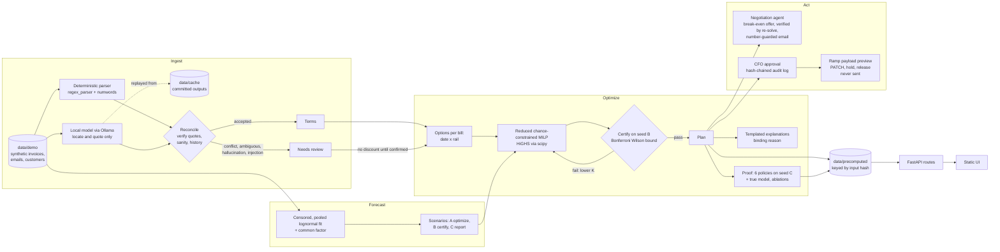

# Architecture

Tempo is a small Python library (`tempo/`) with a thin FastAPI layer (`app/`) and a no-build static frontend (`app/static/`). The library never imports FastAPI. Everything the hosted demo shows is precomputed and committed, so the server only loads files.

## Layers

| Layer | Path | Role |
|---|---|---|
| Assumptions | `tempo/assumptions.py` | Every parameter, labeled SOURCED or ASSUMPTION |
| Data | `tempo/data/` | Seeded synthetic generator (company, vendors, invoices with hard cases, customers) and loader |
| Extraction | `tempo/extract/` | Parser, number words, due dates (EOM/prox), quote verification, reconciliation table, extraction eval |
| AI providers | `tempo/llm/` | One interface: Ollama (local), Cached (replay), Anthropic (disabled unless explicitly allowed) |
| Forecast | `tempo/forecast/` | Censored pooled fit; Monte Carlo inflows with a common factor and truncated sampling |
| Optimizer | `tempo/optimize/` | Options, capacity caps, MILP with exact reductions, certification, baselines, evaluation, cash value, explanations |
| Agent | `tempo/agent/` | Negotiation pricing and verification; number guard for model-written prose |
| Controls | `tempo/audit.py`, `tempo/ramp/payloads.py` | Tamper-evident approval log; Ramp request preview |
| Glue | `tempo/pipeline.py`, `tempo/precompute.py`, `tempo/live.py`, `tempo/report.py`, `tempo/views.py` | Ingest to plannable bills, precompute, live re-solves, JSON views |
| API | `app/` | Routes only; strict request schemas; security headers; throttle on live solves |
| UI | `app/static/` | Vanilla ES modules, Tailwind compiled locally, vendored Chart.js, fonts, and icons |

## Runtime modes

| Mode | Command | Model | Solves at startup |
|---|---|---|---|
| Hosted demo (Render) | `uvicorn app.main:app` with `TEMPO_PROVIDER=cached` | none; committed cache replayed | none; precomputed files loaded |
| Local dev | `make dev` | cached extractions; drafts and replies use Ollama if running | none |
| Live final | `make demo` | Ollama local model for live drafting and reply parsing | none |

## Determinism

One seed (`assumptions.SEED`) derives the scenario seeds A, B, C, D, and the fan seed. HiGHS runs with a time limit, a node limit, and a 0.01% gap. The plan hash is SHA-256 over float-free canonical JSON of each bill's option, dates, and cents. `tests/unit/test_planning.py` checks that two solves give the same hash and that the committed precomputed files match the current inputs.

## Zero external calls

The running app talks only to its own origin. Fonts, Chart.js, and icons are vendored into `app/static/vendor/`. The local model runs on `127.0.0.1`. Ramp is never called: the payload preview is built and shown, never sent. The hosted-model adapter refuses to start unless `TEMPO_ALLOW_EXTERNAL_LLM=1` and a key are both set.
